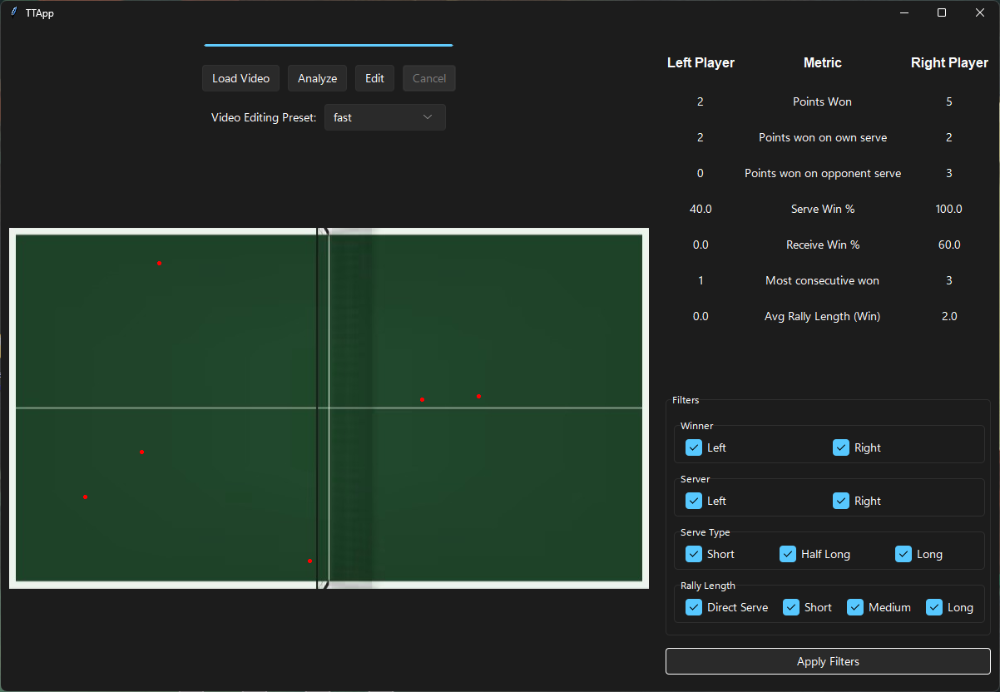
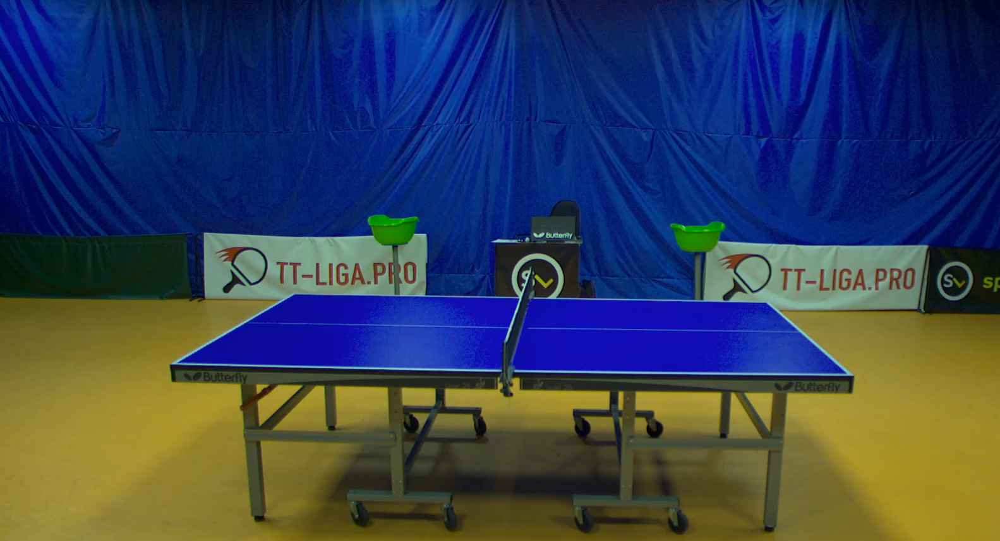

# TTVision

TTVision is a tool for analyzing and editing table tennis matches from video recordings. 




## Overview

TTVision provides two primary capabilities:

* **Analysis** – Extracts statistics and winning bounce positions from table tennis games.
* **Editing** – Automatically edits out dead time from videos, leaving only playing time. 


Ready-to-download builds are available on the [Releases page](https://github.com/azoreofinom/TTApp/releases). Download the build for your operating system and extract the entire package before running it. FFmpeg and FFprobe are included; you do not need to install them separately.

To edit videos from source in the terminal, use Python 3.12 in a fresh virtual environment and run these commands from the project root:

```
python -m pip install --require-hashes --extra-index-url https://download.pytorch.org/whl/cpu -r requirements.txt
```

```
python scripts/fetch_ffmpeg.py
python src/edit_video.py "path/to/video.mp4" --preset fast --encoder auto
```

Use `--output "path/to/edited.mp4"` to choose a destination; otherwise, the edited video is saved beside the input. The setup command downloads the bundled media tools for your platform.

Editing uses sequential clips to keep memory usage bounded. The GUI offers
Hardware (default) and Software (CPU) encoding. Hardware automatically
tests NVIDIA NVENC, AMD AMF, and Intel Quick
Sync, then falls back to CPU encoding. A hardware failure during rendering
restarts all clips on CPU. The command line also accepts `--encoder` with
`auto`, `cpu`, `nvidia`, `amd`, or `intel`. Hardware encoding
requires a supported GPU and compatible graphics driver; CUDA and GPU PyTorch
are not required. Decoding and video analysis remain on CPU.

The editing presets range from `ultrafast` to `veryslow`: `ultrafast`,
`superfast`, `veryfast`, `faster`, `fast`, `medium`, `slow`, `slower`, and
`veryslow`. Faster presets spend less time compressing and usually produce
larger files at similar visual quality. Slower presets spend more time
compressing and can produce smaller files. The exact trade-off depends on the
encoder and footage; output size is not fixed. Hardware encoders map these
choices to their available speed/quality presets, so some choices use the same
hardware preset.

GPU encoding is usually faster, while CPU encoding is often more efficient at
compression (smaller files at comparable quality). Results depend on your CPU,
GPU, drivers, and footage; a GPU is not guaranteed to be faster. Different
encoders can also produce different quality and file sizes with the same
selected preset.

Because the system relies on visual detection of the table and ball, **camera placement and recording conditions are critical** for reliable results. Take a look at the "assumptions" section below. 


## Requirements

The standalone packages include Python, dependencies, model weights, FFmpeg,
and FFprobe. Keep the entire extracted application folder together.

For source setup and building self-contained Windows, macOS, and Linux
packages, see [the build guide](docs/BUILDING.md). Exact Python dependencies
are listed in `pyproject.toml` and locked in `uv.lock`; `requirements.txt`
provides the pinned pip installation used above.


## General recording assumptions

* The camera is **static after the 30 second initialization phase.** If the camera or the table is moved after that, it will lead to **analysis and editing mistakes**
* There is a single table in frame
* **The surface of the table is visible**


## Video editing assumptions
* **Editing  should theoretically work from any angle**
* **The table is fully visibile during dead times and it is ideally not covered by people**


## Video analysis assumptions



* **Filmed from side angle, as shown above**
* **Only one, white ball** is visible in the frame
* **Players do not switch sides during the recording**
* **Serves are legal**
* **Minimal glare on the table surface**
* **Table contrasts clearly with the background**


## Limitations

TTVision may fail or produce unreliable results when:
* The camera moves after the setup period
* Table surface is not visible
* Players or objects block the table
* Multiple balls appear in the frame
* The table color blends with the environment
* Excessive glare or reflections are present

During analysis, let points or players tossing the ball across the table might be counted as points, which is why more points might be found than what were actually played.


## Future Improvements

Potential future features include:

* Support for additional camera angles
* Support for matches where players switch sides
* Stroke-based stats, such as % of points won using backhand flick
* Make certain parameters, such as grace periods and initialization timeout tunable from the GUI
* Export stats feature
* Make analysis work with WTT-style videos (editing, zoom-out, slowly moving camera)

## Acknowledgements

juicy_fish on Flaticon for the desktop icon: https://www.flaticon.com/authors/juicy-fish

This project uses segmentation weights derived from
the TT3D project by the Cognitive Systems Group at the University of Tübingen:

https://github.com/cogsys-tuebingen/tt3d
